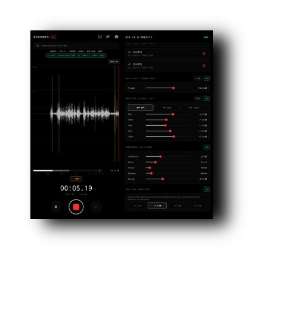

# Rekorder

Ultra-small (**~359 KB**), zero-dependency, pitch-black (`#000000`) AMOLED Android audio recorder engineered for **raw, lossless, unprocessed audio capture** from built-in microphones or USB audio interfaces, with built-in **WAV**, **FLAC**, **OGG Opus**, **MP3**, **RAW PCM**, a studio **Preamp + EQ + Compressor + Normalizer** DSP chain, **independent input & output routing**, non-destructive **Trim & Export**, and crash-safe long-take reliability.

- **License:** [GNU GPL v3.0 or later](LICENSE) (`GPL-3.0-or-later`)
- **Privacy:** 100% offline



## Highlights

- **Custom Native C AAudio Driver (`librekorder_aaudio.so`, ~8 KB/ABI)**:
  - Talks directly to Android's system `libaaudio.so` with zero third-party libraries (no Oboe, no C++ runtime, no AndroidX).
  - Requests `AAUDIO_SHARING_MODE_EXCLUSIVE` + `AAUDIO_PERFORMANCE_MODE_LOW_LATENCY` (hardware MMAP bypass) + `AAUDIO_INPUT_PRESET_UNPROCESSED`.
  - Lock-free C11 atomic SPSC ring buffer (`native/spsc_ring.h`, 2 MiB) so the `SCHED_FIFO` audio callback performs zero locks, zero syscalls, zero allocations, and zero JNI calls.
  - Automatic graceful fallback to direct `AudioRecord` (`UNPROCESSED`), plus seamless mid-recording microphone hot-plug auto-reconnect.
- **Built-in Lossless, Raw & Compressed Formats**:
  - `WAV 24-bit PCM`, `WAV 32-bit IEEE Float` (with `fact` chunk), `WAV 16-bit PCM`
  - `FLAC Lossless (.flac)` via Android's built-in `audio/flac` encoder with exact STREAMINFO sample patching
  - `OGG Opus (.ogg)` (`128 / 192 / 256 / 320 kbps`) via `audio/opus` `MediaCodec` + RFC 3533/7845 `OggMuxer` with OpusTags metadata
  - `MP3 (.mp3)` (`128 / 192 / 256 / 320 kbps` CBR) via Rekorder's **built-in freestanding pure-C MPEG-1 Layer III encoder** (`librekorder_mp3.so`, ~23 KB/ABI, depends only on `libc.so`) with ID3v2.3 tags
  - `RAW 32-bit Float (.pcm)` & `RAW 24-bit PCM (.pcm)`
- **Independent Input & Output Audio Routing**:
  - Select your recording input (e.g. USB condenser mic) completely independently from playback/monitoring output (e.g. **Phone Speaker** or **Wired Headphones**).
  - Persists output selection by both device ID and type across reboots and USB hot-plug events so plugging in a USB mic never hijacks speaker output.
- **Studio DSP Chain & Auto-Apply Presets**:
  - **Input Preamp Gain** (`-12 dB` to `+24 dB`)
  - **High-Pass Filter + 5-Band Equalizer** (`80/120 Hz` Butterworth HPF + `80Hz / 250Hz / 1kHz / 4kHz / 10kHz`, `±12 dB`, 64-bit internal biquad precision)
  - **Soft-Knee Feed-Forward Compressor** (Threshold, Ratio, Attack, Release, Makeup Gain, stereo-linked detection, live `GR dB` telemetry)
  - **Exact 2-Pass True Peak Normalizer** (`-0.5 / -1.0 / -3.0 / -6.0 dBFS`) with live non-blocking progress UI
  - **Presets & Auto-Apply**: 5 built-in presets + custom saved presets and persistent `AUTO-APPLY ON RECORD` toggle (when off, capture remains 100% bit-exact untouched PCM)
- **Long-Take Reliability & Crash Safety**:
  - 15-second crash-safe WAV header checkpointing and automatic 4 GiB seamless multi-part WAV splitting (`_part2.wav`).
  - Automatic startup recovery of interrupted scratch takes into lossless `_recovered.wav` files.
  - Multi-tier encoder fallback rescuing audio to lossless WAV if a hardware codec ever fails, plus low-storage guards.
- **AMOLED UI, Trim/Export & Background Playback**:
  - Pure `#000000` edge-to-edge UI, dual L/R stereo level meters, live `+ MARK` recording bookmarks, `DISCARD TAKE` while paused, live headphone-only monitoring, Quick Settings Record Tile, and custom SAF storage folder.
  - Interactive waveform preview with up to `32x` horizontal pinch-zoom/pan, binary `WaveformCache`, Search/Duration/Rename in Recordings, and non-destructive offline **Trim / Post-Hoc DSP / Format Export**.
  - Full background `PlaybackService` with lock-screen `MediaSession` controls (`-10s` / Play-Pause / `+10s`), `0.5x–2.0x` playback speed, and audio focus handling.

## Reproducible Build & Install

Requires only JDK 17+, `clang` + `lld` (from system packages or Android NDK), `zip`, and Android SDK (`platforms` + `build-tools`):

```bash
# Build bit-for-byte reproducible unsigned APK (used by F-Droid)
./build.sh --unsigned

# Build and sign local APK + install via ADB
./build.sh
adb install -r build/rekorder.apk
```

## Host Unit Tests

```bash
# Native C ring buffer & pure-C MP3 encoder tests
clang -O2 -Wall -Wextra -Inative tests/test_spsc_ring.c -lpthread -o /tmp/test_spsc_ring && /tmp/test_spsc_ring
clang -O2 -Wall -Wextra -Inative native/mp3_encoder.c tests/test_mp3_encoder.c -lm -o /tmp/test_mp3_encoder && /tmp/test_mp3_encoder

# Host JVM tests (DSP, PCM, WAV, Ogg Opus, Normalizer, Resampler)
./build.sh --unsigned
mkdir -p /tmp/rek_tests
javac -cp "$ANDROID_HOME/platforms/android-35/android.jar:build/obj" -d /tmp/rek_tests tests/HostUnitTests.java
java -cp "/tmp/rek_tests:build/obj:$ANDROID_HOME/platforms/android-35/android.jar" HostUnitTests
```
